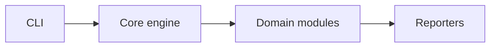

# web-media-scraper — architecture

## Purpose

Single-module `media_scraper.py` orchestration. Non-goals: scraping sites without permission.

## High-level flow

## Module map

| Path | Responsibility |
| --- | --- |
| `media_scraper.py` | Scrape and download logic |
| `setup.sh` / `run.sh` | venv and run helpers |

## Extension

1. Add a module under the appropriate `src/` folder.
2. Register it in the orchestrator (if applicable).
3. Add unit tests with mocks — no live network in unit tests.
4. Run `npm test` and `npm run format:check`.

## Testing strategy

- **Unit**: mocked I/O, pure parsers, reporters.
- **Integration** (if present): live targets documented in README; optional in CI or scheduled.

## Ethics & scope

Authorized engagements only. See [SECURITY.md](./SECURITY.md).
